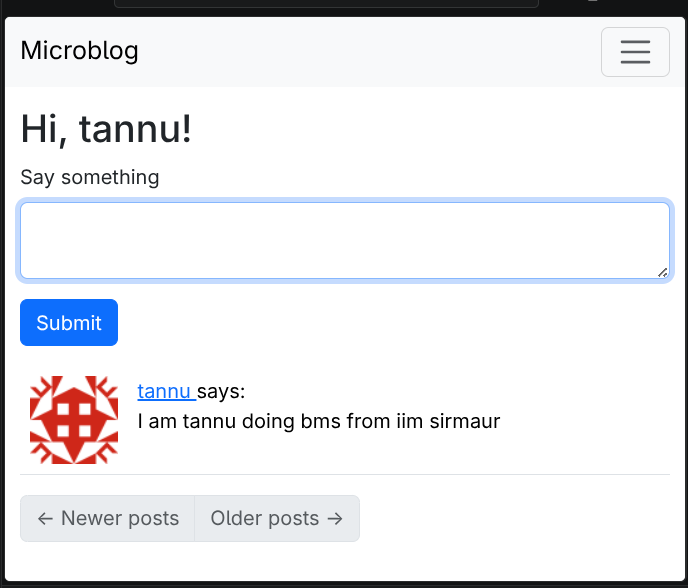

# BlogSite

A full-stack social blogging platform with a Flask backend, built by following Miguel Grinberg's Flask Mega-Tutorial and deployed on a live server. Users can post, follow each other, send private messages and search content. The focus of this project is the backend: database design, authentication, background job, search and deployment.

## Live demo

- **App:**  [http://154.38.170.134:8080](http://154.38.170.134:8080)
- **Docker image:**  [khushii4/microblog](https://hub.docker.com/r/khushii4/microblog)


<p align="center"> 
   
</p>

## Features

- **Accounts:** register, log in and log out with hashed passwords; edit your profile
- **Posts:** create, edit and delete your own posts
- **Social graph:** follow and unfollow users; your feed shows posts from people you follow
- **Private messages:** send text messages to other users
- **Search:** full-text search across posts with Elasticsearch
- **Database migrations:** schema changes are tracked with Flask-Migrate
- **Background tasks:** post export runs as a Redis-backed RQ job, so web requests stay fast. The worker builds a `posts.json` archive, reports live progress, and emails it to the user

## Screenshots

<table>
  <tr>
    <td align="center" width="50%">
      <br>
      <sub>Login page</sub>
    </td>
    <td align="center" width="50%">
      <br>
      <sub>Profile with followers and posts</sub>
    </td>
  </tr>
  <tr>
    <td align="center" width="50%">
      <br>
      <sub>Explore feed of all users' posts</sub>
    </td>
    <td align="center" width="50%">
      <br>
      <sub>Another user's page with follow button</sub>
    </td>
  </tr>
  <tr>
    <td align="center" colspan="2">
      <br>
      <sub>Private messages between users</sub>
    </td>
  </tr>
  <tr>
    <td align="center" width="50%">
      <br>
      <sub>Exported posts.json</sub>
    </td>
    <td align="center" width="50%">
      <br>
      <sub>Export email sent by the background worker</sub>
    </td>
  </tr>
</table>


## Architecture

```
Browser --> Gunicorn + Flask app --> MySQL          (users, posts, followers, messages)
                  |
                  +--> Elasticsearch                (post search)
                  +--> Redis --> RQ worker          (background tasks)
```

All five services run as separate containers, defined in `docker-compose.yml` and connected over a private Docker network. Only the web app is exposed to the internet. MySQL, Redis and Elasticsearch are reachable only from inside Docker.

## Tech stack

| Area | Tools |
| --- | --- |
| Backend | Python, Flask, SQLAlchemy, Flask-Login, Flask-Migrate |
| Database | MySQL |
| Search | Elasticsearch |
| Queue | Redis, RQ |
| Frontend | Jinja templates, Bootstrap |
| Deployment | Docker, Docker Compose, Gunicorn, Contabo VPS |

## Run it locally

1. Clone the repo:
```bash
   git clone https://github.com/Khushiivatsa24/BlogSite.git
   cd BlogSite
```
2. Create your environment file and fill in your own values:
```bash
   cp .env.example .env
```
3. Start all services:
```bash
   docker compose up -d
```
4. Open http://localhost:8080

Database tables are created automatically on startup through migrations.

## Deployment

The image is published on Docker Hub as `khushii4/microblog`. On the server, I copy `docker-compose.yml` and `.env` and run `docker compose up -d`. Secrets live only in `.env` and are never committed to Git.

## What I learned

- How a backend system fits together: the web app, the database, the search service and the background worker, and how data moves between them
- How databases work: designing tables, relationships between users, posts and followers, and migrations when the schema changes
- Debugging: most of my errors started as typos, and chasing them taught me to read error messages carefully and trace a problem to its source.
- Docker networking: containers reach each other by service name (`db`, `redis`, `elasticsearch`), never `localhost`
- How a Dockerfile `ENTRYPOINT` interacts with a compose `command`, which is why my worker first ran the web app instead of RQ
- Persistent data: named volumes for MySQL, and why `docker compose down -v` deletes the database

## Credits

Based on the [Flask Mega-Tutorial](https://blog.miguelgrinberg.com/post/the-flask-mega-tutorial-part-i-hello-world) by Miguel Grinberg. 
